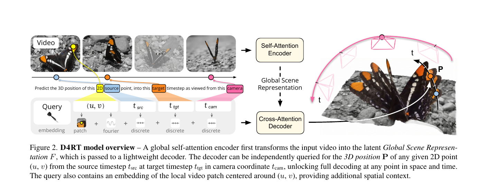
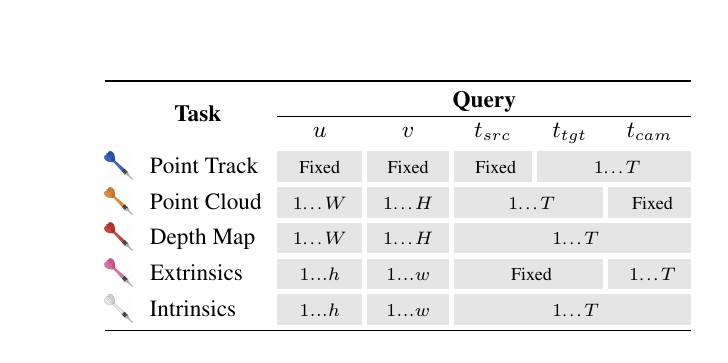
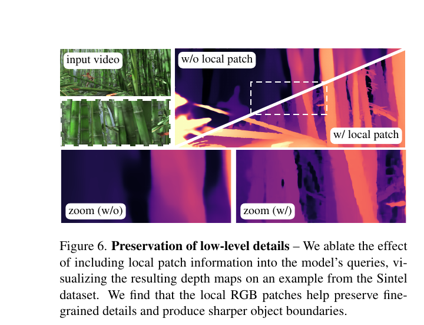
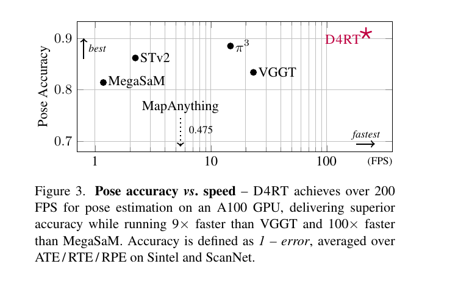
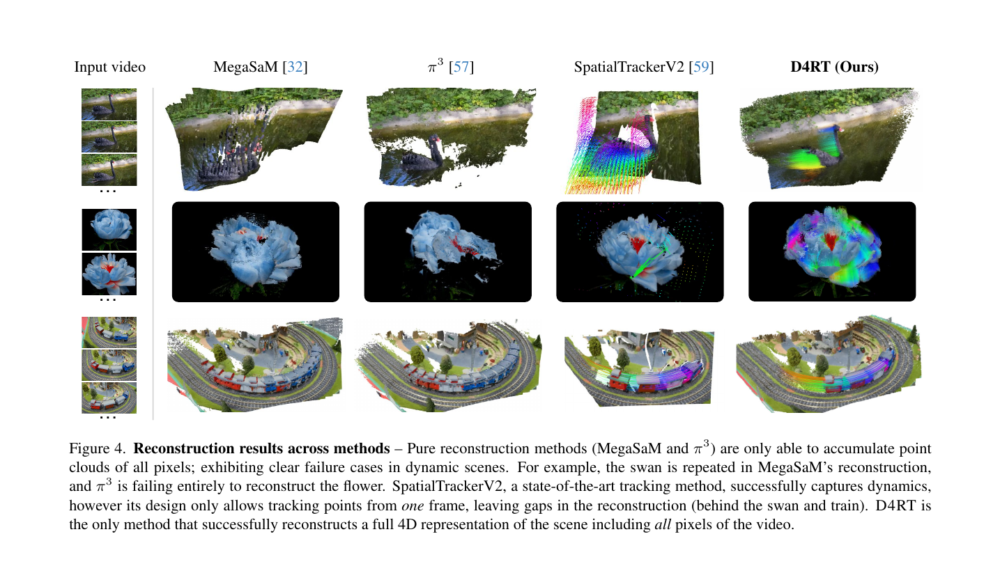
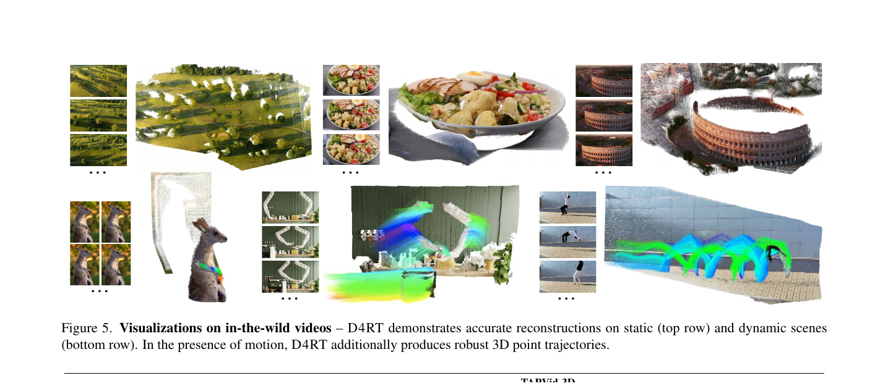
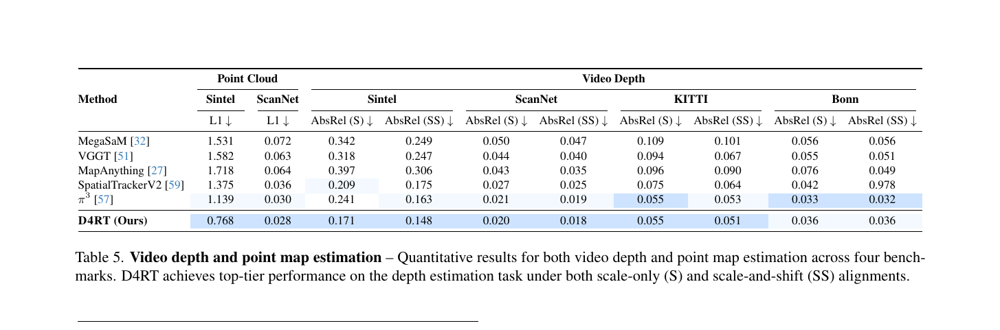
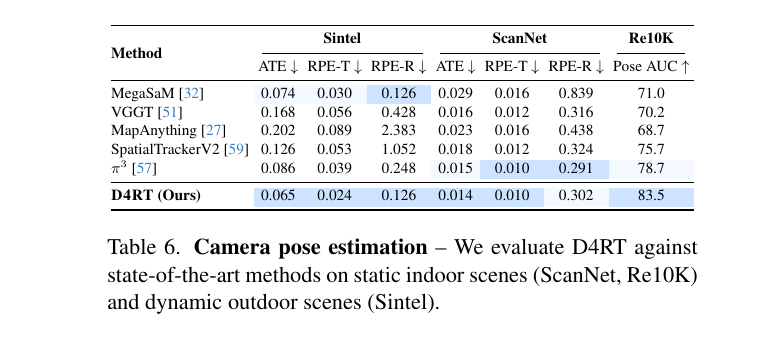
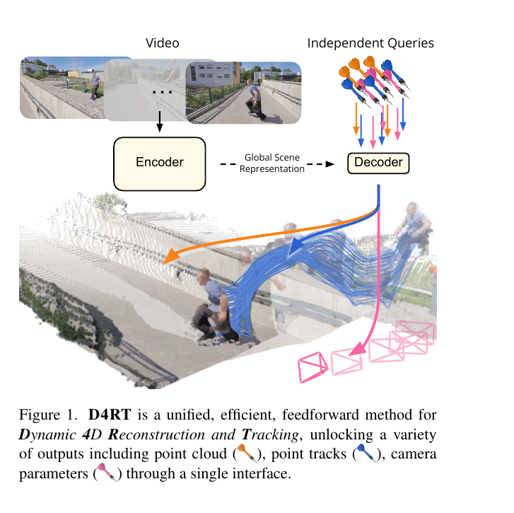
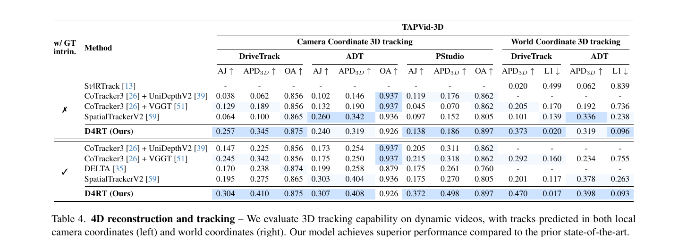

# D4RT 期末論文報告教學

**論文：** Chuhan Zhang 等，*Efficiently Reconstructing Dynamic Scenes One D4RT at a Time*  
**出處：** IEEE/CVF Conference on Computer Vision and Pattern Recognition (CVPR) 2026  
**舉辦地點與時間：** Colorado Convention Center, Denver, Colorado, United States，2026 年 6 月 3 日至 7 日  
（官網：<https://cvpr.thecvf.com/Conferences/2026>；主會議為 6 月 5 日至 7 日，工作坊／教學課程為 6 月 3 日至 4 日，見 <https://cvpr.thecvf.com/Conferences/2026/Dates>）  
**正式 PDF：** Open Access 版，頁碼 7382–7392（11 頁）  
**專案頁：** <https://d4rt-paper.github.io/>  
**課程：** 長庚大學「電腦視覺」，指導教授陳仁暉老師  
**報告組：** 第 17 組　廖晢勛、林威宇（封面報告人順序請自行決定）  
**長度：** 約 15 分鐘

這份文件是「教你怎麼上台講」的講義，不是投影片檔。數字、公式、實驗結果都來自論文正文或專案頁，沒有自行推估。論文提到「詳見附錄」但正式 Open Access 11 頁沒寫出來的細節，會明白標示，不要在台上假裝看過那些數字。

---

## 這份講義怎麼用

1. 先把「一、用大白話把論文講懂」讀兩遍，確定自己能不看稿講出核心想法。
2. 再照「二、投影片逐頁腳本」做 14 張投影片。每一頁都寫了標題、該放哪張圖／表、口語講稿和時間。
3. 圖**一律用論文原圖或專案頁動畫**。老師在 9/9、9/30 上課時說過，他會坐在台下問細節，也討厭一看就知道是 AI 生出來的系統圖。架構圖請直接截 Figure 2，比較圖請用 Figure 4，不要自己叫繪圖工具重畫一套。
4. 封面格式是老師規定的：題目、出處（會議名稱、舉辦城市與國家、年月）、依論文順序列出的全部作者、報告人。建議再寫上指導教授與報告日期。
5. 總時間約 15 分鐘。下面 14 張加起來約 14 分 40 秒，剩下的留給換頁和呼吸，不要再加新內容。

**封面建議寫法（請原樣放上投影片第一頁）：**

- 題目：Efficiently Reconstructing Dynamic Scenes One D4RT at a Time
- 出處：CVPR 2026, Denver, Colorado, United States, June 2026  
  （可在下一行補完整資訊：IEEE/CVF Conference on Computer Vision and Pattern Recognition，Colorado Convention Center，June 3–7, 2026）
- 補充一行：CVPR 2026 Best Paper（來源：<https://cvpr.thecvf.com/Conferences/2026/News/Best_Papers>；此資訊不在論文 PDF 內，已對照 CVPR 官網）
- 作者（請依論文順序全部列出，不要只寫 et al.）：  
  Chuhan Zhang, Guillaume Le Moing, Skanda Koppula, Ignacio Rocco, Liliane Momeni, Junyu Xie, Shuyang Sun, Rahul Sukthankar, Joëlle K. Barral, Raia Hadsell, Zoubin Ghahramani, Andrew Zisserman, Junlin Zhang, Mehdi S. M. Sajjadi
- 單位：Google DeepMind。Skanda Koppula 為 GDM＋University College London；Andrew Zisserman 為 GDM＋University of Oxford；Junyu Xie 只標 University of Oxford，註腳 1 註明是在 Google DeepMind 實習期間完成。通訊作者為 Mehdi S. M. Sajjadi（論文註腳：d4rt@msajjadi.com）。
- 報告人：第 17 組　廖晢勛、林威宇（兩人誰排第一、誰上台主講，請先講好再印封面）
- 指導教授：陳仁暉
- 報告日期：＿＿＿＿年＿＿月＿＿日

---

## 一、用大白話把論文講懂

課堂目前走到 CNN、AlexNet／VGG／Inception、損失函數和資料增強，對深度學習有基本概念，但還沒有系統上過三維幾何。下面從零講起，講完你應該能對老師解釋：「他們到底問了模型什麼問題、為什麼這樣問會比較快、實驗贏在哪、又沒贏在哪。」

### 1.1 問題：從一段普通影片還原會動的立體世界

一般說的「三維重建」，問的是：這個場景的立體形狀是什麼？論文開頭用一句話形容傳統做法：「所有東西、所有地方、同一時間的幾何，一次全部求出來。」這種做法把世界當成一座不會動的雕像。

可是真實影片裡的世界會動：人在走、天鵝在游、火車在開，相機自己也常在移動。這時候你需要的不只是「現在這一幀長什麼樣」，而是：

- 每個可見點離相機有多遠（深度）；
- 把這些點放到同一個三維座標系裡（點雲）；
- 同一個物理點隨著時間跑到哪裡（三維軌跡、對應關係）；
- 每一幀相機在哪、朝哪、鏡頭參數是多少（相機姿勢與內參）。

把「三維空間＋時間」合在一起，就叫 **4D 重建**（四維重建）。D4RT 這個名字，論文 Figure 1 的圖說寫得很清楚：它是 **Dynamic 4D Reconstruction and Tracking**，也就是「動態四維重建與追蹤」。輸入是**一段單目影片**（只有一個一般彩色鏡頭，沒有額外的深度相機、不需要事先給相機參數（不過 Table 4 也測了給真實內參的情況）），輸出則是上面這些幾何量。

為什麼難？因為物件一動，多視角幾何裡「同一點在不同照片上應該對得起來」的假設就會破功。如果方法不理解動態，重建出來的點雲常常會把移動物體「印」很多次。論文 Figure 4 裡，MegaSaM 把天鵝重複疊在水面上，就是這種失敗。

### 1.2 你需要先知道的背景

以下概念課堂還沒系統教，但報告一定會用到。用生活比喻記住即可，公式只保留論文真正用到的那幾個。

**深度（depth）。**  
想像每張照片的每個像素背後都藏著一個問題：「這個點離相機有多遠？」把答案畫成一張跟照片一樣大的圖，就是深度圖。近的地方數值小、遠的地方數值大。論文的深度評估用 Absolute Relative Error（AbsRel，絕對相對誤差）：對每個像素看預測深度和真實深度差多少、再除以真實深度，然後取平均。愈小愈好。

**點雲（point cloud）。**  
知道某個像素的深度之後，可以從相機「射出一條光線」，在對應距離處放一顆三維小點。所有像素都這樣做，場景就變成一堆三維點，稱為點雲。論文 Figure 1 用橘色飛鏢／箭頭代表點雲。

**相機內參（intrinsics）。**  
這是相機「自己的規格」，跟它此刻站在哪裡無關。最常見的針孔相機模型裡，內參主要是焦距（focal length）\(f_x, f_y\)，以及主點（principal point，影像中心大概落在哪）。論文假設主點在正規化座標 \((0.5, 0.5)\)，也就是畫面正中心，因為他們把像素座標 \((u, v)\) 正規化到 \([0, 1]^2\)。

**相機外參／姿勢（extrinsics / pose）。**  
這是相機「在世界裡的位置和朝向」，可以想成相機的定位加上指南針。兩幀之間相機怎麼移動，就是相對姿勢。論文要求的是完整相機參數（full camera parameters），內參和外參都要。

**對應關係（correspondence）與三維追蹤（3D tracking）。**  
對應關係的意思是：第一幀天鵝嘴巴上的這個像素，跟第五幀某個像素，其實是世界上的同一個物理點。把這個點在每一幀的位置串起來，就得到軌跡（point track）。如果軌跡不只是影像上的 \((x, y)\)，還包含深度或三維座標，就是三維追蹤。物件被擋住再出現（occlusion，遮蔽），是追蹤最討厭的情況之一。論文也會預測該點在目標時刻看不看得到（visibility，可見性）。

**座標系：相機座標 vs. 世界座標。**  
「用某一幀相機的眼睛來看」叫相機座標（local / camera coordinates）；「把整段影片放到同一個固定座標系」叫世界座標（world coordinates）。論文 Table 4 左右兩邊分別評估這兩種。世界座標比較難，因為模型還得隱含地換參考系。

**Transformer 的編碼器、解碼器與查詢（query）。**  
你們已經見過 CNN 用卷積掃描影像。這篇的骨幹是 Vision Transformer（ViT）：先把影像切成小塊（patch），再用注意力機制讓這些小塊互相看。  

- **編碼器（encoder）** 負責把整段影片讀完，壓縮成一組特徵，論文叫它 Global Scene Representation \(F\)（全域場景表徵）。可以想成：先把整部影片做成一份詳盡筆記。  
- **解碼器（decoder）** 不一次把所有像素的所有結果都倒出來，而是接受一個「問題」，再去筆記裡找答案。  
- 這個問題就叫 **query（查詢）**。論文的 query 不是聊天機器人那種自然語言，而是一組明確的數字，下面 1.3 會寫。

**前饋（feedforward）對上測試時優化（test-time optimization）。**  
前饋的意思是：影片送進網路，往前跑一次（再加上若干次查詢）就得到答案，不必在測試時反覆迭代優化。論文拿來對比的 MegaSaM，要把好幾個現成模型的輸出拼起來，再做計算很貴的測試時優化，才能讓幾何一致。D4RT 走的是前饋這條路。

### 1.3 核心想法：不要一次解出全世界，一次只問一個點

先前的前饋方法常有兩個負擔：

1. **每幀密集解碼**：每一幀的每個像素都要產出完整結果，算力很重。
2. **每個任務一個解碼器**：深度一個頭、姿勢一個頭、點雲一個頭，系統又雜又慢。論文說 VGGT 就是用多個專門解碼器處理不同模態；這些方法通常也無法為場景中「會動的部分」建立對應關係。SpatialTrackerV2 有處理動態，但仍不是單一階段的統一公式，而要靠昂貴的反覆 refinement。

D4RT 的轉變是：改成 **按需查詢（on-demand querying）**。架構靈感來自 Scene Representation Transformer（SRT）。如 Figure 2：

1. 編碼器先把影片變成固定的全域特徵 \(F = \mathcal{E}(V) \in \mathbb{R}^{N \times C}\)。這份 \(F\) 算好就暫時不動。
2. 解碼器之後可以對任意多個 query 做 cross-attention，每個 query 獨立產出一個三維點 \(\mathbf{P} = \mathcal{D}(\mathbf{q}, F) \in \mathbb{R}^3\)。

Query 定義成五元組：

\[
\mathbf{q} = (u,\ v,\ t_{\mathrm{src}},\ t_{\mathrm{tgt}},\ t_{\mathrm{cam}})
\]

用大白話講，就是在問：

> 「來源幀 \(t_{\mathrm{src}}\) 上座標 \((u, v)\) 的這個二維點，在目標時間 \(t_{\mathrm{tgt}}\) 時，如果改用第 \(t_{\mathrm{cam}}\) 幀的相機座標系來寫，它的三維位置 \(\mathbf{P}\) 在哪裡？」

三個時間索引**不必相同**，於是空間和時間被拆開：

- \((u, v, t_{\mathrm{src}})\) 是來源：你指的是影片裡哪一個看到的點；
- \(t_{\mathrm{tgt}}\) 是目標時間：你想知道它「那時」在哪（物體可能已經移動）；
- \(t_{\mathrm{cam}}\) 是參考相機：你想用「哪一臺相機的眼睛」來寫這個三維座標。

Figure 2 的蝴蝶圖就是這個意思：左邊在某幀點選翅膀上的一點，右邊畫出它隨時間移動、以及從不同相機位置看過去的三維位置。

論文強調這個設計的三個性質：索引不必重合，從而把空間和時間解開；獨立解碼讓訓練、推論都能只算你需要的點，可疏可密；同一套介面就能做很多下游任務（見 Table 1）。

### 1.4 一個介面，五種輸出（Table 1）

只要改 query 怎麼取，同一個解碼器就能做不同工作：

| 任務 | 怎麼問（對應 Table 1 與第 2.1 節正文） | 你得到什麼 |
| --- | --- | --- |
| 點軌跡 Point Track | \((u,v,t_{\mathrm{src}})\) 固定，令 \(t_{\mathrm{tgt}} = t_{\mathrm{cam}} = \{1,\ldots,T\}\) | 這個點整段影片的三維軌跡 |
| 點雲 Point Cloud | 問影片裡所有像素，令 \(t_{\mathrm{src}}=t_{\mathrm{tgt}}\) 一起走過 \(1\ldots T\)，\(t_{\mathrm{cam}}\) 固定成同一個參考幀 | 所有點都寫在同一個座標系，不必再靠可能有雜訊的相機估計去做座標變換 |
| 深度圖 Depth Map | 令 \(t_{\mathrm{src}} = t_{\mathrm{tgt}} = t_{\mathrm{cam}}\)，只留下 \(\mathbf{P}\) 的 Z 分量 | 每一幀的深度 |
| 外參 Extrinsics | 在粗網格 \((h,w)\) 上取點，對兩幀 \(i,j\) 分別問 \(\mathbf{q}_i=(u,v,i,i,i)\)、\(\mathbf{q}_j=(u,v,i,i,j)\) | 同一批三維點在兩個座標系的位置，再用 Umeyama 演算法（一次 \(3\times 3\) SVD）求剛體變換，得到相對相機姿勢 |
| 內參 Intrinsics | 對第 \(i\) 幀令 \(t_{\mathrm{src}}=t_{\mathrm{tgt}}=t_{\mathrm{cam}}=i\)，同樣在粗網格上取點，解出 \(\mathbf{P}=(p_x,p_y,p_z)\) | 假設針孔模型、主點在 \((0.5,0.5)\)，則 \(f_x = p_z(u-0.5)/p_x\)，\(f_y = p_z(v-0.5)/p_y\)，對 \(k\) 個估計取中位數以求穩健 |

相機內參、外參只查詢較粗的 \((h,w)\) 網格，是為了加快推論。若相機有畸變（例如魚眼），論文說可以在初步估計之上再加一步非線性 refinement。

重點：**網路並沒有另開一個「姿勢頭」直接輸出相機矩陣。** 姿勢是從「同一批點在兩個座標系的三維位置」推回來的。老師若追問細節，這一點一定要講得出來。

### 1.5 架構長什麼樣

**編碼器 \(\mathcal{E}\)。** 以 Vision Transformer 為基礎，交錯使用「單一幀內部的局部 self-attention」和「跨幀的全域 self-attention」（寫法追隨 VGGT）。為了處理任意長寬比，他們先把影片 resize 成固定的正方形再切成 token；原本的長寬比另外做成一個 token，跟影像 token 一起送進 Transformer。

正式模型的編碼器是 **ViT-g**：40 層，時空 patch 大小為 \(2\times 16\times 16\)，約 **10 億**個參數。初始化用公開的 **VideoMAEv2** 預訓練權重。論文寫這一步對成功很關鍵；若改成隨機初始化，效能會明顯下降，細節在附錄第 D 節，正式 11 頁沒有列出下降了多少。

**解碼器 \(\mathcal{D}\)。** 一個小型的 cross-attention Transformer，正式模型是 **8 層、1.44 億**個參數，比編碼器輕得多。每個 query token 的組成是：

- \((u, v)\) 的 Fourier feature embedding；
- \(t_{\mathrm{src}}\)、\(t_{\mathrm{tgt}}\)、\(t_{\mathrm{cam}}\) 三個學來的離散時間 embedding；
- 再加上以 \((u, v)\) 為中心的 **\(9\times 9\) 局部 RGB patch** embedding。

最後用一個簡單的學習投影，把解碼器輸出變成三維點 \(\mathbf{P}\)。論文特別做實驗發現：若讓 query 彼此做 self-attention，不但更貴，還會讓模型過度擬合訓練時的 query 分佈，測試時效能大幅下降。所以他們堅持每個 query 獨立解碼。

那空間和時間的一致性從哪裡來？不是靠 DPT、CoTracker 那類沉重、彼此耦合的解碼機制，而是故意把解碼器做輕，逼編碼器把場景理解寫進全域特徵 \(F\) 裡，用 \(F\) 來隱含地維持全域一致。

**\(9\times 9\) 局部影像塊為什麼重要？** 兩個原因（第 4.4 節）：局部外觀幫助 query 跟編碼後的時空特徵對得更準；這些小塊也提供低階線索，有助於把物體從背景分開，預測因此更細。

Figure 6 用 Sintel 的竹子畫面示範：沒有 local patch 的深度圖邊緣糊成一團，加上之後葉子和桿子的邊界清楚許多。Table 7 用 ViT-L 在 Sintel 上比較，加了 patch 之後，深度 AbsRel（僅對齊尺度）從 0.366 降到 0.302，相機 ATE 從 0.173 降到 0.091。論文用「dramatic」形容這個提升。

### 1.6 怎麼訓練

實作框架是 Kauldron，端到端最小化一批 \(N\) 個取樣 query 上的加權損失。注意：這裡的 \(N\) 是 query 數，和 \(F\in\mathbb{R}^{N\times C}\) 裡的 \(N\)（token 數）不是同一個東西，論文沿用了同一個字母。

**主損失：** 對正規化後的三維點位置 \(\mathbf{P}\) 做 L1。預測點集合和真實點集合都會先各自除以自己的平均深度（做法追隨 DUSt3R），再通過

\[
\mathrm{sign}(x)\cdot\log(1+|x|)
\]

降低遠方點對損失的影響力。

**輔助損失：** 從解碼器輸出再做幾個線性投影，分別監督：

- 影像平面上的二維座標（L1）；
- 三維表面法向（cosine similarity）；
- 目標點是否可見（binary cross-entropy）；
- 點的運動向量（L1）。

有真實標註的地方才算對應損失。另外還有信心懲罰 \(-\log(c)\)，且 \(c\) 會再用來加權三維點誤差。

**訓練設定（正式模型）：**

- 公開資料混合：BlendedMVS、Co3Dv2、Dynamic Replica、Kubric、MVS-Synth、PointOdyssey、ScanNet++、ScanNet、TartanAir、VirtualKITTI、Waymo Open，**再加上內部資料集**；
- 48 幀、解析度 \(256\times 256\) 的片段；
- 每個影片解碼 2048 個隨機 query，並在特定區域過採樣（過採樣細節見附錄，正式 11 頁沒寫）；
- AdamW，500k steps，local batch size 為 1，64 顆 TPU，總訓練時間「just over 2 days」（兩天多一點）。

為了回應「內部資料能不能重現」的疑慮，他們另外訓練了只用公開資料的版本，並在附錄第 D 節表示這個版本仍保持最先進、仍勝過對照方法。正式 11 頁沒有列出那組數字，台上不要編造。

消融實驗（第 4.4 節）預設改用較小的 ViT-L 編碼器、6 層解碼器，訓練 300k 次、batch size 16，都在較難的 Sintel 上報告深度與相機姿勢。

### 1.7 為什麼有效率

效率來自同一件事：解碼器又輕、又疏、又獨立。

**訓練時**不必為影片裡每一個可能的點算損失，只要監督抽到的那一小批 query，記憶體和計算量都下降。

**推論時** query 可以平行計算。要稀疏軌跡就少問幾點，要密點雲就多問，不必綁死「整張圖一次解完」。

**追蹤所有像素**如果傻做，每個像素、每一對時間都問一次，query 數量是 \(O(T^2 H W)\)，大多數其實多餘，因為同一條軌跡會重複經過很多像素。論文提出 **Algorithm 1**：

1. 先算一次 \(F\)；
2. 做一個大小為 \(T\times H\times W\) 的佔用格點 \(G\)，記錄哪些時空像素已經被拜訪過；
3. 只從尚未拜訪的像素展開新軌跡；
4. 一條貫穿整段影片的軌跡，會把它沿途「看得到」的像素都標成已拜訪。

實測可依影片運動複雜度，得到約 **5 到 15 倍**的適應性加速。這件事只有「解碼器既稀疏又輕量」才划算：先前許多方法根本無法為動態區域提供對應；採密集逐幀解碼的方法仍會落入那種昂貴的笨作法；解碼器很重的稀疏方法則是每多問一個點就很痛。

速度數字請記這兩處（硬體都是單張 **A100 GPU**）：

- Figure 3：姿勢估計超過 **200 FPS**，準確度優於對照方法，同時比 VGGT 快 **9 倍**、比 MegaSaM 快 **100 倍**。準確度定義為 \(1 - \mathrm{error}\)，把 Sintel 與 ScanNet 上的 ATE／RTE／RPE 平均起來。為了公平，他們還拿掉對照方法裡與相機估計無關的解碼頭，讓對照方法更快，D4RT 仍然又準又快。
- Table 3：在指定 FPS 下能產出的「整段影片三維軌跡」數量。D4RT 在 60／24／10／1 FPS 分別是 550、1,570、3,890、40,180 條；SpatialTrackerV2 是 29、84、219、2,290；DELTA 是 0、5、408、5,770。論文寫 D4RT 比其他方法快 **18 到 300 倍**。這是論文的概括說法。依表格自己算：對 SpatialTrackerV2 各檔位約 18 倍；對 DELTA，24 FPS 約 314 倍，但 10 FPS 約 9.5 倍、1 FPS 約 7 倍。台上請說「論文宣稱」。注意：D4RT 的每一條軌跡，其實是 \(T\) 個獨立 query。

### 1.8 主要結果：整體是新的最先進，但不是每一格都贏

講結果時請帶表號，不要只說「全面超越」。論文自己的用詞是 sets a new state of the art、superior performance、top-tier，同時表格裡有些格子的最佳值並不在 D4RT 那一列。老師若盯著某一格問，老實說比較好看。

**定性（Figure 4、Figure 5，以及專案頁動畫）。**

Figure 4 用三個例子把故事講完：

- 純重建方法（MegaSaM、\(\pi^3\)）只能把各幀像素累積成點雲，不懂動態。MegaSaM 把天鵝重複印在水上；\(\pi^3\) 論文寫成完全重建不出花朵（failing entirely）。
- SpatialTrackerV2 能抓住動態，但設計上只能從**一幀**出發追蹤，天鵝後方和火車後方會留下空洞。
- D4RT 是唯一把影片裡**所有像素**都重建進完整 4D 表徵的方法。

Figure 5 展示野外影片：上排偏靜態（例如建築、食物），下排有動態並畫出彩色三維軌跡（例如動物、人物）。專案頁還有可旋轉的互動 4D 重建；為了網頁載入，每個場景最多拿掉 90% 的點，示範時要提一句，免得老師以為原論文的點雲這麼稀疏。

**三維追蹤（Table 4，TAPVid-3D：DriveTrack、ADT、PStudio）。**

指標：AJ（3D Average Jaccard）、APD\(_{3D}\)（Average percent of points within delta）、OA（Occlusion Accuracy）都是愈高愈好；世界座標另報 L1，愈低愈好。分「沒有／有真實內參」兩大塊。PStudio 沒有相機運動，所以世界座標那一欄省略（會跟相機座標等價）。

沒有真實內參時，D4RT 在 DriveTrack 相機座標為 AJ 0.257、APD\(_{3D}\) 0.345、OA 0.875，明顯高於次佳的 CoTracker3+VGGT（0.129／0.189／0.856）和 SpatialTrackerV2（0.064／0.100／0.865）。PStudio 同樣是 D4RT 最高（0.138／0.186／0.897）。世界座標的提升更大：DriveTrack 的 APD\(_{3D}\)／L1 為 0.373／0.020，對照 CoTracker3+VGGT 的 0.205／0.170、SpatialTrackerV2 的 0.101／0.139。

但 **ADT 這一子集並非全面領先**。沒有真實內參時，SpatialTrackerV2 的 AJ 0.260、APD\(_{3D}\) 0.342、OA 0.936，都高於 D4RT 的 0.240、0.319、0.926；世界座標 APD\(_{3D}\) 也是 SpatialTrackerV2 的 0.336 略高於 D4RT 的 0.319，不過 D4RT 的 L1 0.096 遠低於 0.238。有真實內參時，D4RT 在 ADT 的 AJ／APD\(_{3D}\) 以 0.307／0.408 略超過 SpatialTrackerV2 的 0.303／0.404，OA 仍是對照方法較高（0.936／0.937 對上 D4RT 的 0.926）。DriveTrack 與 PStudio 在有真實內參時則由 D4RT 大幅領先，例如 PStudio 的 AJ／APD\(_{3D}\) 為 0.372／0.498，對上 CoTracker3+VGGT 的 0.215／0.318。

**點雲與深度（Table 5）。**

點雲先依 MegaSaM 的作法做 mean-shifting 對齊，再報平均 L1（愈低愈好）。D4RT 在動態的 Sintel 為 0.768、靜態的 ScanNet 為 0.028，都是表上最好（次佳 \(\pi^3\) 分別為 1.139 與 0.030）。

深度在對齊後算 AbsRel，分「只對齊尺度（S）」和「尺度加平移（SS）」兩種。D4RT 在 Sintel 為 0.171／0.148（最好，論文特別說 Sintel 因高度動態而最難），ScanNet 為 0.020／0.018（最好），KITTI 為 0.055／0.051（S 與 \(\pi^3\) 並列 0.055，SS 則 D4RT 較好）。**Bonn 則是 \(\pi^3\) 較好**（0.033／0.032 對上 D4RT 的 0.036／0.036）。論文對深度的表述是 top-tier，不是「每一格第一」。另外 SpatialTrackerV2 在 Bonn 的 SS 變成 0.978，屬明顯失敗，不要拿來當主要攻擊點，帶到即可。

**相機姿勢（Table 6 與 Figure 3）。**

Sintel 用 14 段含動態模糊與大氣效果的子集，先做 Sim(3) 對齊再算 ATE、RPE-T（相對平移）、RPE-R（相對旋轉），愈低愈好；Re10K 報 Pose AUC@30，愈高愈好。D4RT：Sintel ATE／RPE-T／RPE-R 為 0.065／0.024／0.126，ScanNet 為 0.014／0.010／0.302，Re10K AUC 為 83.5。Sintel 的 ATE、RPE-T，ScanNet 的 ATE（0.014），以及 Re10K AUC 都是最好；Sintel RPE-R 與 MegaSaM 並列 0.126；ScanNet RPE-T 與 \(\pi^3\) 並列 0.010；**ScanNet RPE-R 則是 \(\pi^3\) 的 0.291 略好於 D4RT 的 0.302**。

**消融（Table 7–9、Figure 6）。**

- Local RGB patch：見 1.5 節與 Table 7、Figure 6。  
- 編碼器由 ViT-B（9,000 萬參數）放大到 ViT-g（10 億）：Table 8 顯示深度與 RPE-R 明顯變好。Sintel 上 AbsRel（S／SS）從 ViT-B 的 0.319／0.232 降到 ViT-g 的 0.191／0.168，RPE-R 從 0.266 降到 0.160。但 ViT-g 的 ATE 0.078 略差於 ViT-H 的 0.070 和 ViT-L 的 0.073，論文強調的是深度與 RPE-R 的提升，不要說「愈大愈全面變好」。  
- 輔助損失（Table 9，數字是相對完整 D4RT 的增減，正值代表誤差變大）：拿掉二維位置損失，深度 AbsRel（S）+0.071；拿掉法向 +0.043；拿掉位移是全面小幅變差；拿掉可見性反而讓深度稍微變好（−0.003／−0.025）但姿勢變差（ATE +0.012）；拿掉信心項對姿勢打擊最大（ATE +0.126、RPE-T +0.061、RPE-R +0.115）。論文的結論是：深度和姿勢之間有一點取捨，但整體而言所有輔助損失都有幫助，所以都保留。

### 1.9 限制與你上台時可以怎麼說

論文**沒有獨立的 Limitations 小節**。下面這些是正文裡看得到、或表格裡直接讀得到的限制，不要自行腦補「下雨就會失敗」這類論文沒寫的話。

1. 不是每一項指標都第一：ADT（尤其無真實內參時）、Bonn 深度、ScanNet 的 RPE-R，都有對照方法持平或更好。  
2. 正式模型的訓練混有內部資料集。作者有做「只用公開資料」的對照，並稱仍為最先進，但數字在附錄，正式 11 頁看不到。  
3. 論文說 VideoMAEv2 初始化很關鍵（critical），換成隨機初始化會明顯下降（附錄有細節，主文沒給數字）。  
4. 訓練用 48 幀、\(256\times 256\)。主文沒有系統分析「更長、更高解析度」會怎樣。  
5. 獨立 query 讓複雜度隨「你要重建的點數」線性成長；這是優點，但也代表要極密的全像素結果時，仍然要問很多點。他們用 Algorithm 1 把全像素追蹤從 \(O(T^2HW)\) 降下來。  
6. 標準流程假設針孔相機；魚眼等畸變要再加非線性 refinement。  
7. 論文與專案頁（我們讀到的內容）沒有釋出官方程式碼或預訓練權重，所以這堂課無法現場跑 demo，只能播專案頁上的動畫與互動檢視器。  
8. 一致性靠編碼器隱含維持，沒有像經典 SfM／COLMAP 那樣用明確的多視角幾何約束。經典方法較可解釋，但論文也指出它們計算昂貴且脆弱。

你自己的評論可以這樣收：這篇能成為最佳論文，不是因為每一格數字都贏，而是它把「深度、對應、相機」收成一個非常乾淨的問題（問一個點的三維位置），同時在多數基準上達到最先進，並且快一個數量級。這句話有論文的 Figure 3、Table 2 到 Table 6 撐腰，比較站得住。

---

## 二、投影片逐頁腳本（14 張，約 15 分鐘）

做投影片時，每一頁只放一個重點、一張論文原圖或一個表。畫面上用短詞、關鍵字就好，不要寫完整句子的條列。講稿用自己平常用的口語講，不必逐字背；但表上的數字請背熟或做一張小抄，不要現場從論文讀錯。

時間總覽：

| 頁 | 標題 | 時間 |
| --- | --- | --- |
| 1 | 封面 | 0:40 |
| 2 | 動態 4D 重建 | 1:00 |
| 3 | 跟以前的方法比 | 1:20 |
| 4 | 幾個會用到的名詞 | 1:00 |
| 5 | 方法：用 query 問三維位置 | 1:20 |
| 6 | 五種輸出，同一套 query | 0:50 |
| 7 | 編碼器與解碼器 | 1:00 |
| 8 | 為什麼比較快 | 1:00 |
| 9 | 重建結果 | 1:20 |
| 10 | 追蹤（Table 4） | 1:00 |
| 11 | 點雲、深度、姿勢 | 1:00 |
| 12 | 消融實驗 | 0:50 |
| 13 | 限制 | 0:40 |
| 14 | 小結 | 0:30 |
| | **合計** | **14:30** |

### 第 1 頁｜封面（0:40）

**畫面：** 標題、Best Paper、出處（含 Denver, Colorado, United States, June 2026）、14 位作者全名、單位、第 17 組報告人（廖晢勛、林威宇）、指導教授陳仁暉。不要放自己生的插圖，也不要做成宣傳海報。

**講稿：**

「老師好、各位同學好，我們是第 17 組。今天要報告的是 CVPR 2026 最佳論文，題目是 Efficiently Reconstructing Dynamic Scenes One D4RT at a Time。主要單位是 Google DeepMind，也有倫敦大學學院跟牛津大學。第一作者是 Chuhan Zhang，通訊作者是 Mehdi Sajjadi。會議是 2026 年 6 月，在美國丹佛的 Colorado Convention Center。大概十五分鐘，我們會講它要解決什麼問題、query 怎麼用，還有實驗數字。作者很多，我們就不一一唸，投影片上有照論文順序排好。」

口頭不必把 14 個名字念完，但投影片一定要依論文順序列出。若老師問作者單位，記得 Xie 與 Zisserman 掛牛津，Koppula 同時掛 UCL。

### 第 2 頁｜動態 4D 重建（1:00）

**畫面：** Figure 1 為主。旁邊只標三個詞：點雲、三維軌跡、相機參數。顏色對應原圖圖說（橘、藍、粉），不要另行發明圖示。

**講稿：**

「一般在講三維重建，我們理解是在還原一個靜止的形狀，有點像幫一座雕像做掃描。可是影片裡面的東西會動，相機也常常在動。所以我們要的不只是某一幀長什麼樣子，還想知道每個點之後跑去哪，還有每一幀相機在哪裡、朝哪裡。論文把三維空間加上時間，叫做 4D 重建。」

「D4RT 這個名字，Figure 1 的圖說有寫，是 Dynamic 4D Reconstruction and Tracking，也就是動態四維重建跟追蹤。輸入就是一般單目影片。論文說，不用另外給深度，也不用先給相機參數。圖上橘色是點雲、藍色是軌跡、粉色是相機。」

### 第 3 頁｜跟以前的方法比（1:20）

**畫面：** 左放 Table 2。右放短詞，不要做成三張對稱卡片。分兩塊寫：這篇不一樣的地方；沒贏的地方。

- 單一前饋模型：深度、姿勢、追蹤同一套
- 以前：多個模型拼接，或測試時再優化
- 只解有問到的點，所以比較快
- 會動的場景：π³ 這類方法會失敗（Figure 4）
- 沒贏：ADT、沒給真實內參時 SpatialTrackerV2 較好；Bonn 深度、ScanNet 旋轉誤差是 π³ 較好

**講稿：**

「那這篇跟以前比，到底有什麼不一樣？左邊是論文 Table 2。以前像 MegaSaM，是好幾個現成模型拼起來，深度、運動分割分開做，測的時候還要再做一輪很貴的優化。VGGT 這類前饋方法比較新，可以一次看很多張圖，可是不同輸出常常還是不同的解碼頭，動態對應也比較弱。SpatialTrackerV2 有在做動態追蹤，但論文說它不是單階段，還要反覆 refinement。」

「我們自己整理，D4RT 比較不一樣的大概有三點。第一，深度、姿勢、追蹤是同一個前饋模型，不是分開訓練再拼回去。第二，解碼的時候只回答你問到的那些點，所以比較快，數字在後面 Figure 3。第三，它處理會動的場景。像 π 三次方這種方法，論文在 Figure 4 寫說，那朵花它完全重建不出來。」

「不過要先講老實話，它不是每一格都贏。ADT 這個子集、又沒有給真實內參的時候，SpatialTrackerV2 的 AJ 跟 APD3D 比較高。Bonn 的深度，還有 ScanNet 的旋轉誤差，是 π 三次方比較好。這些數字我們講表格的時候會再對一次。」

### 第 4 頁｜幾個會用到的名詞（1:00）

**畫面：** 六個名詞，用短詞加一句解釋即可，不要做成五張一樣大的卡片。

**講稿：**

「先很快對一下名詞，不然後面會卡住。深度就是每個像素離相機多遠；有深度就可以把像素放回三維，變成點雲。內參是鏡頭自己的規格，像焦距、畫面中心，跟相機現在站哪裡無關。外參是相機的位置跟朝向。對應的意思是，這一幀這個像素跟後面某一幀那個像素，其實是世界上的同一個點；串起來就是軌跡，加上三維座標就是三維追蹤。」

「座標可以用某一幀相機的眼睛來寫，也可以把整段影片放到同一個世界座標。還有，單鏡頭分不出來是近處的小東西，還是遠處的大東西，所以論文做評估前會先對齊整體尺度，再比形狀。」

### 第 5 頁｜方法：用 query 問三維位置（1:20）

**畫面：** Figure 2（這頁的主角，務必用原圖）。下方只重寫一次五元組，不要重繪蝴蝶與相機軌跡。

**講稿：**

「這張是 Figure 2，我們覺得是整篇最重要的圖。左邊影片先經過 self-attention 編碼器，變成論文講的 Global Scene Representation，記作 F。F 算完就固定住。」

「右邊是比較輕的 cross-attention 解碼器。它不是一次把整張圖吐出來，而是等我們提問。提問有五個數字：u、v、來源時間 t src、目標時間 t tgt，還有參考相機 t cam。白話就是：來源幀上的這個二維點，到了目標時間，用這個相機座標系來寫，它的三維位置 P 在哪？」

「三個時間可以不一樣。我們理解是：來源時間決定你指的是哪個點，目標時間決定物體已經移動到哪，參考相機決定你用誰的眼睛寫座標。這樣空間跟時間就被拆開了。每個 query 是分開回答的。」

「D4RT 唸起來像 dart，圖裡的 query 也畫成飛鏢。標題說 One D4RT at a Time，我們的解讀是一次問一個點。」

### 第 6 頁｜五種輸出，同一套 query（0:50）

**畫面：** Table 1 原表。旁邊用短詞註明怎麼問，不要再寫一大段完整句子。

**講稿：**

「有這一句問法之後，很多任務其實只是換怎麼問，這是 Table 1。固定一個像素，讓目標時間跟參考相機一起從第 1 幀走到第 T 幀，得到的是這個點的三維軌跡。如果問很多像素、但相機時間固定，而且 t src 等於 t tgt、一起走過 1 到 T，就是同一個座標系下面的點雲。三個時間都設成同一幀，只看 P 的 Z，就是深度。」

「相機參數也走同一套。外參是對兩幀問同一批點，再用 Umeyama 做一次 3 乘 3 的 SVD，求出剛體變換。內參用紙上的針孔公式反推焦距，最後對很多點取中位數。所以它沒有另外再訓練一個專門輸出姿勢的頭。」

### 第 7 頁｜編碼器與解碼器（1:00）

**畫面：** 左右兩欄關鍵字即可，可再放一小張 Figure 2 當提示。不要生架構爆炸圖，也不要做成深色標題卡。

**講稿：**

「編碼器是 ViT-g，40 層，時空 patch 是 2 乘 16 乘 16，大概 10 億參數。它會交錯做同一幀裡的局部注意力，還有跨幀的全域注意力。影片會先被縮成正方形，原本的長寬比另外當成一個 token 送進去。初始化用的是公開的 VideoMAEv2。」

「解碼器比較輕，只有 8 層 cross-attention，1.44 億參數。Query 是座標的 Fourier 特徵，加上三個時間的嵌入，再加上 9 乘 9 的局部彩色小塊。作者沒有讓 query 之間做 self-attention。論文的理由包含會比較吃計算量，也怕模型太適應訓練時的 query 分佈；他們寫早期實驗打開之後，推論表現有下降。」

「訓練是 48 幀、256 乘 256，每次監督 2048 個 query，AdamW 訓練 50 萬步，64 顆 TPU，兩天多。」

### 第 8 頁｜為什麼比較快（1:00）

**畫面：** 左半 Algorithm 1 三個短步驟，右半 Figure 3，下方放 Table 3。數字用原文表格，不要做成大海報式的對比條。

**講稿：**

「它會快，主要是因為只解有問到的點。如果每個像素都追，笨做法的 query 數量會到 T 平方乘長乘寬，很多是重複的。Algorithm 1 用佔用格記住哪些位置已經走過，只從沒走過的像素再長新軌跡，論文說大概可以快 5 到 15 倍。」

「Figure 3 把準確度跟速度畫在一起。論文寫，一張 A100 上做姿勢估計可以超過每秒 200 幀，比 VGGT 快 9 倍，比 MegaSaM 快 100 倍。Table 3 是維持每秒 24 幀的時候，單張 A100 能同時算幾條整段影片的三維軌跡：D4RT 是 1,570 條，SpatialTrackerV2 是 84 條。論文宣稱快 18 到 300 倍；如果拆開看，對 SpatialTrackerV2 大概 18 倍，對 DELTA 要看 FPS 檔位，大約 7 到 314 倍。台上我們會講這是論文宣稱的數字。」

### 第 9 頁｜重建結果（1:20）

**畫面：** Figure 4 為主。若教室網路穩定，可再穿插專案頁動畫約 20 到 30 秒，並準備 Figure 4、Figure 5 當備案。

**講稿：**

「先看 Figure 4，這張滿直觀的。第一列天鵝，MegaSaM 把移動中的天鵝在水面上印了很多次，因為它沒有把動態對應起來，只是把各幀的點疊在一起。中間 π 三次方，論文的原話是完全重建不出第二列那朵花。SpatialTrackerV2 有抓住動態，可是它只能從單一幀開始追，天鵝後面、還有第三列火車後面，都會缺一塊。」

「最右邊 D4RT，天鵝沒有分身，花是完整的，火車那邊也能把各幀看到的像素補起來。論文寫，它是唯一有成功重建、而且包含影片所有像素的完整 4D 結果的方法。如果教室網路可以的話，我們後面可以再播一下專案頁的動畫，大概 20 秒。」

### 第 10 頁｜追蹤（Table 4）（1:00）

**畫面：** Table 4 主表。下方用三行短註即可，不要再做三張數字卡。

**講稿：**

「數字在 TAPVid-3D，有 DriveTrack、ADT 跟 PStudio。Table 4 左邊是相機座標的三維追蹤，右邊是世界座標。AJ、APD3D、遮蔽準確率都是愈高愈好。」

「先看沒有給真實內參的設定。DriveTrack 上面，D4RT 的 AJ 是 0.257，比 CoTracker3 加 VGGT 的 0.129、還有 SpatialTrackerV2 的 0.064 高。PStudio 也是它最高。右邊世界座標差比較多，DriveTrack 的 L1 到 0.020，對照方法都在 0.1 以上。」

「不過要老實講，ADT 又沒給真實內參的時候，SpatialTrackerV2 的 AJ 是 0.260、APD3D 是 0.342，比 D4RT 的 0.240 跟 0.319 高，遮蔽準確率也略高。有真實內參的時候，D4RT 在 ADT 的 AJ 跟 APD3D 才有略為超前。所以論文講 superior performance，是就整體來說，不是每一格都第一。」

### 第 11 頁｜點雲、深度、姿勢（1:00）

**畫面：** Table 5，下方用短行補 Table 6 的數字，以及沒贏的格子。

**講稿：**

「Table 5 左邊是點雲平均 L1。動態比較強的 Sintel，D4RT 是 0.768，次佳 π 三次方是 1.139；比較靜態的 ScanNet 是 0.028，也是最好。」

「深度看絕對相對誤差。Sintel 是 0.171 跟 0.148，也是最好；ScanNet 也是第一。可是 Bonn 是 π 三次方比較好，0.033、0.032，D4RT 是 0.036、0.036。論文自己的用詞是 top-tier。」

「姿勢在 Table 6。Sintel 跟 ScanNet 的 ATE 都是最好，分別是 0.065 跟 0.014。Sintel 的相對旋轉誤差 0.126，跟 MegaSaM 並列。ScanNet 的相對旋轉誤差，π 三次方是 0.291，D4RT 是 0.302，這裡是對方比較好。Re10K 的 Pose AUC 是 83.5，次佳 78.7。」

### 第 12 頁｜消融實驗（0:50）

**畫面：** Figure 6 加 Table 7–9 的短註。

**講稿：**

「作者有做消融，看這些設計是不是真的有用。Figure 6 跟 Table 7 是 query 要不要帶 9 乘 9 的局部彩色小塊。沒有小塊的時候，Sintel 竹子的深度邊界會比較糊；加上以後邊緣清楚很多。同一套 ViT-L，深度誤差從 0.366 降到 0.302，相機 ATE 從 0.173 降到 0.091。」

「Table 8 是編碼器愈大，深度跟相對旋轉誤差大致愈好。不過 ViT-g 的 ATE 是 0.078，沒有比 ViT-H 的 0.070 更好，所以放大模型主要是幫到深度跟旋轉。」

「Table 9 裡面，二維位置跟法向比較幫深度；信心值比較幫相機姿勢，拿掉的話 ATE 會增加 0.126。」

### 第 13 頁｜限制（0:40）

**畫面：** 三點短詞。清楚標示這些是我們從正文和表格整理的，論文沒有獨立的 Limitations 小節。

**講稿：**

「論文沒有單獨寫 Limitations 這一節，我們是看正文跟表格自己整理的。第一，不是所有指標都第一，剛才講的 ADT、Bonn 深度、ScanNet 旋轉誤差就是。第二，訓練有混內部資料。作者有說只用公開資料也還是最先進，可是那些數字在附錄，正式 11 頁看不到。第三，訓練是 48 幀、256 乘 256，更長或更高解析的影片，正文沒有系統分析。」

### 第 14 頁｜小結（0:30）

**畫面：** 三行短句加專案頁網址。不要做成三張一樣大的卡片。

**講稿：**

「我們收成三句就好。第一，它用同一個 query 去問任意點的三維位置，深度、點雲、追蹤、相機參數都走這一套。第二，因為只解有問到的點，所以比較快，A100 上姿勢估計論文寫可以超過每秒 200 幀。第三，多數 4D 基準是領先的，但我們也有講它不是每一格都贏。以上是第 17 組的報告，謝謝老師，歡迎提問。」

---

## 三、老師可能會問的問題

老師說過他會坐在台下請你們解釋細節，答不出來會扣分。下面每題都給「可以上口的答案」。原則是：知道就講論文裡的原委和表號；不知道就說「這篇正式論文沒有寫」，不要臨場編數字。

**1. D4RT 這個名字是什麼意思？**  
Dynamic 4D Reconstruction and Tracking，動態四維重建與追蹤。出處是 Figure 1 的圖說。標題 One D4RT at a Time，我們的解讀是：一次用一個獨立 query（圖裡畫成飛鏢）去問一個點；論文正文並沒有親自解釋這個標題。

**2. 什麼是 4D 重建？跟普通三維重建差在哪？**  
三維重建恢復空間中的幾何；4D 還要加上時間，也就是動態場景裡的運動與對應。D4RT 除了幾何，還同時估相機參數。傳統方法常把世界當成靜止的，遇到移動物體就容易出現 Figure 4 那種「同一個天鵝被印很多次」的錯誤。

**3. Query 的五個數字各代表什麼？為什麼三個時間可以不一樣？**  
\(\mathbf{q}=(u,v,t_{\mathrm{src}},t_{\mathrm{tgt}},t_{\mathrm{cam}})\)。\((u,v)\) 是來源幀上正規化到 0 到 1 的二維座標；\(t_{\mathrm{src}}\) 是你指的那一幀；\(t_{\mathrm{tgt}}\) 是你想知道該點在哪個時刻的位置（物體可能已移動）；\(t_{\mathrm{cam}}\) 是用哪一幀的相機座標系來寫這個三維點。論文第 2.1 節說 indices need not coincide，也就是這三個時間不必相同，從而把空間和時間拆開。

**4. 深度、軌跡、相機怎麼可能共用一個解碼器？**  
因為這些輸出都來自同一個三維點 \(\mathbf{P}\)，差別只在 query 怎麼取，見 Table 1。軌跡是固定來源點、改變時間；深度是三個時間設成同一幀後取 Z；相機外參是同一批點在兩個座標系下的 \(\mathbf{P}\) 再跑 Umeyama；內參是用針孔模型從 \(\mathbf{P}\) 反推焦距。

**5. 網路有沒有直接輸出相機矩陣？Umeyama 是在做什麼？**  
沒有專門的姿勢頭。對兩幀 \(i,j\)，他們在粗網格上取同一組 \((u,v)\)，分別問 \(\mathbf{q}_i=(u,v,i,i,i)\) 和 \(\mathbf{q}_j=(u,v,i,i,j)\)，得到同一批三維點在兩個參考系的座標，再求兩組點之間的剛體變換。Umeyama 演算法用一次 \(3\times 3\) 的 SVD 就能解這個變換。

**6. 內參那條公式怎麼來的？主點為什麼是 (0.5, 0.5)？**  
針孔模型裡，像素座標和相機座標下的三維點滿足相似三角形：\(u-c_x \approx f_x \cdot p_x / p_z\)。他們把 \((u,v)\) 正規化到 \([0,1]^2\)，並假設主點在畫面中心 \((0.5,0.5)\)，整理後就是 \(f_x=p_z(u-0.5)/p_x\)、\(f_y=p_z(v-0.5)/p_y\)。對網格上 \(k\) 個點各算一次，再取中位數以增加穩健性。

**7. 為什麼 query 之間不做 self-attention？獨立解碼不會不一致嗎？**  
論文說，query 互動不但增加計算，也會造成訓練／測試的 query 分佈偏移，因為模型會過擬合訓練時抽到的 query 組合。他們在早期實驗觀察到，打開 query 之間的 self-attention 後，推論效能明顯下降。一致性改由編碼器寫進全域特徵 \(F\) 來維持，而不是靠解碼器互相對答案。

**8. 9×9 local patch 真的有差嗎？差多少？**  
有，而且論文稱為 dramatic。Figure 6 顯示沒有 patch 時深度邊界模糊，有 patch 時細節清楚。Table 7（ViT-L、Sintel）：深度 AbsRel（S／SS）從 0.366／0.306 降到 0.302／0.257，ATE 從 0.173 降到 0.091。原因有兩個：局部外觀讓對應更可靠；低階線索有助於把物體從背景分開。

**9. 主損失為什麼要先除平均深度，還要再取 log？**  
預測點和真實點都先除以各自的平均深度（追隨 DUSt3R）。論文只寫沿用 DUSt3R，沒寫理由；我們的理解是用來去掉整體尺度差異，否則遠近不同的場景無法直接比 L1。接著做 \(\mathrm{sign}(x)\cdot\log(1+|x|)\)，論文明文寫是為了降低遠方點對損失的影響，避免極遠的點主導梯度。

**10. Algorithm 1 到底在省什麼？複雜度是多少？**  
若為每個像素、每一對時間都問一次，是 \(O(T^2HW)\) 個 query。Algorithm 1 用佔用格點 \(G\in\{0,1\}^{T\times H\times W}\)，只從尚未拜訪的像素長出新的整段軌跡，並把該軌跡沿途可見的像素標成已拜訪，藉此利用時空冗餘。實測加速約 5 到 15 倍，幅度取決於影片的運動有多複雜。

**11. Table 4 是不是全面第一？ADT 怎麼解釋？**  
不是。整體上 D4RT 在 DriveTrack、PStudio 以及世界座標追蹤上領先很多，所以論文說 superior performance。但在 ADT、無真實內參時，SpatialTrackerV2 的 AJ、APD\(_{3D}\)、OA 都較高（0.260／0.342／0.936 對 0.240／0.319／0.926）；該欄 OA 最高的是兩個 CoTracker3 組合的 0.937；世界座標 APD\(_{3D}\) 也是 0.336 對 0.319，不過 D4RT 的 L1 好很多（0.096 對 0.238）。有真實內參時，D4RT 在 ADT 的 AJ／APD\(_{3D}\) 略為超前，OA 仍略低。建議回答：「我們報告整體結論，同時指出 ADT 是最接近、甚至部分被超前的子集。」

**12. Table 5、Table 6 有沒有輸的地方？**  
有。深度在 Bonn 上 \(\pi^3\) 更好（0.033／0.032 對 0.036／0.036）。KITTI 的 scale-only AbsRel 與 \(\pi^3\) 並列 0.055。相機姿勢方面，Sintel 的 RPE-R 與 MegaSaM 並列 0.126；ScanNet 的 RPE-T 與 \(\pi^3\) 並列 0.010；ScanNet 的 RPE-R 是 \(\pi^3\) 的 0.291 略好於 0.302。點雲兩欄以及 Sintel／ScanNet 深度、Sintel ATE、ScanNet ATE、Re10K AUC 則是 D4RT 最好。

**13. 跟 MegaSaM、VGGT、SpatialTrackerV2 各差在哪？請看 Table 2。**  
Table 2 的欄位是：三維重建、動態對應、彈性參考幀、稀疏解碼、全域上下文、單一解碼器。MegaSaM 只有三維重建打勾，其餘沒有，它走的是拼接現成模型再做測試時優化。VGGT 有三維重建和全域上下文，但沒有動態對應，也不是單一解碼器。\(\pi^3\) 多了彈性參考幀。St4RTrack 有動態對應，但沒有彈性參考幀、稀疏解碼、全域上下文和單一解碼器。SpatialTrackerV2 有動態對應、稀疏解碼和全域上下文，但仍不是彈性參考幀，也不是單一解碼器，而且依賴反覆 refinement。只有 D4RT 六項全勾。

**14. 訓練資料有內部資料集，結果能重現嗎？預訓練有多重要？**  
作者承認用了 internal datasets，因此在附錄第 D 節做了「只用公開資料」的版本，並寫它仍保持最先進、仍勝過對照方法；正式 11 頁沒有那組分數。編碼器初始化用公開的 VideoMAEv2，正文說這對成功很關鍵，隨機初始化會明顯下降，細節同樣在附錄第 D 節，主文沒給數字。公開訓練資料名稱則有列在正文：BlendedMVS、Co3Dv2、Dynamic Replica、Kubric、MVS-Synth、PointOdyssey、ScanNet++、ScanNet、TartanAir、VirtualKITTI、Waymo Open。

**15. 什麼是 feedforward？跟測試時優化差在哪？為什麼 Figure 3 要拿掉對照方法的部分解碼頭？**  
Feedforward 指測試時做前向計算（編碼一次，再查詢若干點）就得到答案，不必為每一段影片再做迭代優化。MegaSaM 需要測試時優化來強迫幾何一致，所以慢，Figure 3 顯示它比 D4RT 慢約 100 倍。作者為了公平，拿掉對照方法裡跟相機估計無關的解碼頭，讓那些方法更快，D4RT 仍然在準確度和速度上同時領先。

**16. 魚眼相機或更長的影片可以嗎？你們有沒有跑過官方程式？**  
論文說帶畸變的相機模型（例如魚眼）可以在初步估計上再加非線性 refinement，並引用張正友那類校正文獻；主文沒有單獨的魚眼定量實驗。訓練片段是 48 幀、\(256\times 256\)，主文沒有給「數分鐘長影片」的系統分析。官方程式碼方面：論文指向專案頁，我們在專案頁上沒有看到釋出的程式碼或權重，因此報告使用論文原圖與專案頁動畫，沒有自己跑模型。這樣回答比假裝跑過更安全。

**17. Figure 3 下方那個 0.475 的箭頭是什麼？**  
圖上 MapAnything 的點落在縱軸可見範圍（約 0.7 起）下方，作者用向下的虛線標出 0.475，表示它的姿勢準確度（定義為 1−error，平均 ATE／RTE／RPE）只有 0.475，比圖上其他方法低一截。D4RT 則同時位在最上方（最準）與最右方（最快，超過 200 FPS）。

**18. 輔助損失這麼多，會不會互相打架？**  
Table 9 確實出現取捨：拿掉可見性或信心項，有些深度指標會變好，但姿勢變差；拿掉二維位置或法向，深度明顯變差，RPE-R 卻稍微變好。作者仍然寫：整體而言所有輔助損失都提升整體表現，因此正式模型全都使用。

---

**19. Table 1 的點雲 query 是 \(t_{\mathrm{src}}=t_{\mathrm{tgt}}\)，那移動的天鵝不是也會被印好幾次嗎？為什麼 Figure 4 的 D4RT 沒有分身？**  
照 Table 1 的點雲問法，每個像素寫的是它在自己那一幀的位置，動的物體確實會留在不同位置，這也是 Table 5 點雲評估的設定。但三個時間可以不一樣（§2.1），而且 §2.3 可以用 Algorithm 1 對所有像素做密集追蹤，組成完整場景重建（Fig. 4）。我們的理解是：要得到某一時刻沒有分身的完整場景，就把 \(t_{\mathrm{tgt}}\) 固定。Figure 4 確切用了哪一種 query 組合，正文沒有寫。

**20. 你們說 D4RT 是「單一解碼器」，可是它還輸出二維位置、法向、可見性、位移、信心值，這跟 VGGT 的多個頭差在哪？**  
那些是同一個解碼器輸出再接的線性投影（§2.3），主要用途是輔助監督（Table 9）；主要介面還是三維點 \(\mathbf{P}\)，深度、點雲、軌跡和相機都從 \(\mathbf{P}\) 推出來。VGGT 這類方法是每個任務一個獨立解碼頭（§3.1）。

**21. Table 4 有「給真實內參」的版本，真實內參要怎麼給 D4RT？**  
11 頁正文沒有說明輸入方式。我們只能確定 Table 4 有這兩種設定，而且在 DriveTrack、PStudio 上，給了真實內參分數都會提升（例如 PStudio 的 AJ 從 0.138 升到 0.372）。

**22. 為什麼 Table 4 裡 OA 不管有沒有給真實內參都一樣？**  
Table 4 裡每個方法的 OA 在兩種設定下完全相同（D4RT 都是 0.875／0.926／0.897；SpatialTrackerV2 都是 0.865／0.936／0.805）。我們的理解是：遮蔽是「看不看得到」的判斷，跟焦距大小無關。CoTracker3 加兩種深度模型的 OA 也一樣，因為遮蔽判斷來自同一個二維追蹤器。

**23. 為什麼消融實驗（Table 7–9）的 Sintel 數字比 Table 5、6 差這麼多？Table 7 和 Table 8 的 ViT-L 為什麼不一樣？**  
消融用的是比較小的設定（ViT-L、6 層解碼器、300k 次、batch 16；§4.4），正式模型是 ViT-g、8 層、500k steps，所以不能直接比，只看同一張表裡的相對差異。Table 7 有 patch 的 ViT-L 是 0.302／0.257／0.091，跟 Table 9 的 D4RT 列一樣；Table 8 的 ViT-L 卻是 0.256／0.214／0.073。正文沒有解釋這個差異，不確定就老實說不知道。

**24. Table 3 說快 18–300 倍，可是 1 FPS 時 40,180 除以 5,770 只有大約 7 倍？**  
倍數要看跟誰比、在哪個 FPS 檔位比。跟 SpatialTrackerV2 比，四個檔位都大約 18 倍；跟 DELTA 比，24 FPS 時大約 314 倍，10 FPS 時大約 9.5 倍，1 FPS 時大約 7 倍，60 FPS 時 DELTA 一條都做不到。「18–300 倍」是論文的概括說法，不是每一格都成立。

**25. 時間 embedding 是學來的離散向量，訓練時只用 48 幀，影片超過 48 幀怎麼辦？**  
§2.2 說三個時間用 learned discrete timestep embeddings，訓練片段是 48 幀。11 頁正文沒有說明更長的影片怎麼處理，也沒有給長影片實驗。

**26. 為什麼評估前都要先對齊？這樣不是幫自己作弊嗎？**  
只用一支鏡頭本來就無法確定絕對尺度（這是一般原理，不是論文獨有的說法），所以深度用 scale-only 或 scale-and-shift 對齊（§4.3），點雲用 mean-shift，姿勢用 Sim(3)。所有方法都用同一套對齊，比較才公平；論文也寫這是沿用先前研究的做法。

**27. Algorithm 1 有 while 迴圈，這樣還算 feedforward 嗎？**  
算。迴圈只是決定接下來要問哪些點，每次都是把 query 送進解碼器做前向計算，沒有梯度、也沒有測試時優化。編碼器 \(F\) 只算一次。加速幅度取決於運動有多複雜（5–15 倍）。

**28. 編碼器有 10 億參數，姿勢估計為什麼還能比 VGGT 快 9 倍？200 FPS 是指每秒處理 200 張影格嗎？**  
論文給的理由是：解碼器很輕、相機只查詢粗網格（Table 1 圖說）、query 可平行計算，再用一次 3×3 SVD 解出姿勢。正文沒有拆開編碼器和解碼器各花多少時間，也沒有說明 Figure 3 測速用的影片長度和解析度。照圖說講「在 A100 上，姿勢估計超過 200 FPS」即可。

**29. 一段影片裡焦距會變（變焦）也可以嗎？**  
§3.1 批評很多方法不支援影片中途改變內參。D4RT 的內參是每一幀各自用 query 求出來的（§2.1），所以架構上允許每一幀有不同內參。不過正文沒有專門測變焦影片。

**30. 內參公式裡的 \(f_x\) 單位是什麼？點剛好在畫面中心時公式不就除以零了？**  
因為 \((u,v)\) 已正規化到 \([0,1]\)，算出來的 \(f_x\) 是相對於影像寬度的正規化焦距，不是像素。點靠近中心時 \(p_x \approx 0\) 確實不穩，所以論文對 \(k\) 個點的估計取中位數以求穩健。

---

## 四、名詞小辭典

| 英文 | 中文 | 在本篇裡的意思 |
| --- | --- | --- |
| Depth / depth map | 深度／深度圖 | 每個像素離相機的距離；D4RT 取 \(\mathbf{P}\) 的 Z 分量得到 |
| Point cloud / point map | 點雲／點圖 | 把像素反投影到三維後得到的點集合 |
| Camera intrinsics | 相機內參 | 鏡頭內部規格，主要是焦距與主點 |
| Focal length \(f_x, f_y\) | 焦距 | 針孔模型裡決定視角「拉近多少」的參數 |
| Principal point | 主點 | 光軸打在影像上的位置；本篇假設為 \((0.5, 0.5)\) |
| Camera extrinsics / pose | 相機外參／姿勢 | 相機在空間中的位置與朝向 |
| Pinhole camera | 針孔相機模型 | 最基本的成像模型，本篇估計內參時的假設 |
| Monocular video | 單目影片 | 只有一個一般彩色鏡頭拍到的影片 |
| Dynamic scene | 動態場景 | 除了相機，場景裡的物體也會移動 |
| 4D reconstruction | 四維重建 | 三維幾何加上時間（運動與對應） |
| Correspondence | 對應關係 | 不同幀上的像素是否為同一個物理點 |
| Point track / 3D tracking | 點軌跡／三維追蹤 | 同一個物理點隨時間的（三維）路徑 |
| Occlusion | 遮蔽 | 點暫時被擋住、從畫面消失 |
| Visibility | 可見性 | 該點在目標時刻能否被看到；本篇用 BCE 監督 |
| Query | 查詢 | 本篇指定的五元組 \((u,v,t_{\mathrm{src}},t_{\mathrm{tgt}},t_{\mathrm{cam}})\) |
| Encoder / decoder | 編碼器／解碼器 | 先把整段影片編成 \(F\)，再依 query 解出 \(\mathbf{P}\) |
| Global Scene Representation \(F\) | 全域場景表徵 | 編碼器輸出、之後保持固定的影片特徵 |
| Self-attention | 自注意力 | token 之間互相看；編碼器裡有幀內與跨幀兩種 |
| Cross-attention | 交叉注意力 | 解碼器讓 query 去看 \(F\) |
| Vision Transformer (ViT) | 視覺 Transformer | 把影像切成 patch 再做注意力的骨幹 |
| Patch | 影像塊 | 切給 ViT 的小塊；query 另帶 9×9 局部 RGB 小塊 |
| Feedforward | 前饋 | 測試時一次（或數次平行）前向計算，不做測試時迭代優化 |
| Test-time optimization | 測試時優化 | 對每一段測試影片再做最佳化，如 MegaSaM |
| Sparse / dense decoding | 稀疏／密集解碼 | 只問部分點，或問所有像素 |
| Occupancy grid | 佔用格點 | Algorithm 1 用來標記已拜訪時空像素的 \(T\times H\times W\) 陣列 |
| Umeyama’s algorithm | Umeyama 演算法 | 用 SVD 求兩組三維點之間的剛體變換，藉此得外參 |
| SVD | 奇異值分解 | Umeyama 裡那次 \(3\times 3\) 分解 |
| Sim(3) alignment | 相似變換對齊 | 評估姿勢前允許對齊尺度、旋轉、平移 |
| Scale-only / scale-and-shift | 只對齊尺度／尺度加平移 | Table 5 深度評估的兩種對齊方式 |
| AbsRel | 絕對相對誤差 | 深度誤差除以真實深度後再平均，愈低愈好 |
| ATE / RPE | 絕對軌跡誤差／相對姿勢誤差 | 評估相機軌跡的平移與旋轉誤差 |
| AJ / APD\(_{3D}\) / OA | 平均 Jaccard／誤差閾內百分比／遮蔽準確率 | Table 4 的三維追蹤指標，前三者愈高愈好 |
| SOTA | 最先進水準 | state of the art |
| Ablation | 消融實驗 | 拿掉某個設計，看分數怎麼變 |
| SfM / MVS / COLMAP | 運動恢復結構／多視角立體／COLMAP | 經典三維重建流程，明確約束幾何，但較慢也較脆 |
| VideoMAEv2 | 視訊掩碼自編碼器第二版 | 本篇編碼器的公開預訓練起點 |

---

## 五、上台提醒

**時間。** 15 分鐘是論文報告，不是作業報告；作業三次都只要交電子檔。請用手機或手錶計時。第 5 頁（Figure 2）和第 9 頁（Figure 4 加動畫）最容易超時，動畫以 20 到 30 秒為限，不要現場滑專案頁看到忘記講話。

**用原圖。** 架構用 Figure 2，故事用 Figure 4，細節用 Figure 6，速度用 Figure 3，數字用 Table 1 到 Table 9。不要讓 AI 重畫系統圖，也不要把論文圖改成另一套配色以免老師認不出來。

**數字怎麼講。** 先講表號，再講資料集，再講數字，最後講「愈高愈好還是愈低愈好」。遇到 ADT、Bonn、ScanNet RPE-R，主動承認沒贏，會比被老師抓到更加分。

**公式怎麼講。** 台上只需兩條：query 五元組，以及 \(f_x=p_z(u-0.5)/p_x\)。Umeyama 講「對兩組三維點做 SVD 求剛體變換」即可，除非老師追問再展開。

**被問倒時。** 標準句：「這點論文正文沒有給數字／沒有單獨分析，我不確定。」比編造安全。附錄第 C、D 節（subpixel、隨機初始化、只用公開資料）正式 11 頁都沒有細節，不要假裝看過。

**封面與組員順序。** 老師 9/30 說：列第一的是三次作業的主要負責人，列第二的是上台報告的人，兩人不能是同一個；作業以第一位為主、報告以第二位為主，七三比。9/9 又曾說列第一的人要上台 15 分鐘。兩堂課說法不完全一樣，封面印之前最好再問助教黃成璿。無論誰主講，另一位也要讀這份講義，因為老師可能對台上任何一個人提問。

**專案頁備案。** 教室網路不穩時很常見。請事先把 <https://d4rt-paper.github.io/> 的比較動畫、All Pixels Tracking 以及互動檢視器錄成短影片，放在投影片裡離線播放。記得補充：互動展示為了縮小檔案，最多移除了 90% 的點。

**發音小抄（口頭介紹用，不必全念）：**  
Chuhan Zhang、Guillaume Le Moing（吉奧姆・勒穆昂）、Skanda Koppula、Ignacio Rocco、Liliane Momeni、Junyu Xie、Shuyang Sun、Rahul Sukthankar、Joëlle Barral（喬埃爾）、Raia Hadsell、Zoubin Ghahramani（祖賓・蓋拉馬尼）、Andrew Zisserman（安德魯・紀斯門，課堂若已聽過老師的講法，跟老師即可）、Junlin Zhang、Mehdi Sajjadi（梅赫迪・薩賈迪）。\(\pi^3\) 口頭說「pi three」或「派三次方」，不要唸成 epsilon。

**台風。** 講 Figure 2 時用手依序指出四個顏色框：黃的 2D 點 (u, v)、藍的來源時間 t_src、橙的目標時間 t_tgt、粉的參考相機 t_cam；時間軸上的藍、橙、粉圓點也是同樣的對應。講 Figure 4 時依「天鵝分身 → 花重建失敗 → 火車缺口 → D4RT 補滿」這條故事線指過去，不要同時講三列。結束後停住、道謝，把總結頁留在螢幕上方便老師提問。

---

## 附錄 A　數字速查卡（提問前掃一眼）

**模型：** 編碼器 ViT-g、40 層、patch \(2\times16\times16\)、10 億參數；解碼器 8 層、1.44 億參數；query 帶 9×9 RGB patch。訓練：48 幀、\(256\times256\)、2048 個 query、AdamW、500k steps、64 TPU、兩天多。初始化：VideoMAEv2。

**速度（A100）：** 姿勢估計 >200 FPS，比 VGGT 快 9 倍、比 MegaSaM 快 100 倍（Figure 3）。軌跡吞吐見 Table 3：60 FPS 時 550 條（對照 29 與 0），論文宣稱 18–300 倍（對 STv2 約 18 倍；對 DELTA 依檔位約 7–314 倍）。Algorithm 1 加速 5–15 倍。

**Table 4（無真實內參，D4RT）：** DriveTrack 0.257／0.345／0.875；ADT 0.240／0.319／0.926（此列未全面領先）；PStudio 0.138／0.186／0.897；世界座標 DriveTrack 0.373／0.020，ADT 0.319／0.096。  
**Table 4（有真實內參，D4RT）：** DriveTrack 0.304／0.410／0.875；ADT 0.307／0.408／0.926；PStudio 0.372／0.498／0.897；世界座標 0.470／0.017 與 0.398／0.093。

**Table 5（D4RT）：** 點雲 L1：Sintel 0.768、ScanNet 0.028。深度 AbsRel S／SS：Sintel 0.171／0.148，ScanNet 0.020／0.018，KITTI 0.055／0.051，Bonn 0.036／0.036（Bonn 非最佳）。

**Table 6（D4RT）：** Sintel 0.065／0.024／0.126；ScanNet 0.014／0.010／0.302；Re10K AUC 83.5。

**Table 7（有／無 local patch，ViT-L，Sintel）：** 無 0.366／0.306／0.173／0.031／0.262；有 0.302／0.257／0.091／0.028／0.245。

---

## 附錄 B　資料來源

- 論文正式 Open Access PDF（與接受版相同，僅多浮水印），頁 7382–7392。
- 專案頁 <https://d4rt-paper.github.io/>（摘要、方法示意、能力說明、互動 4D 重建、作者貢獻）。
- CVPR 2026 會議地點與日期：<https://cvpr.thecvf.com/Conferences/2026>、<https://cvpr.thecvf.com/Conferences/2026/Dates>。
- 最佳論文公告：<https://cvpr.thecvf.com/Conferences/2026/News/Best_Papers>（16,092 篇投稿、4,089 篇錄取；本篇為 Best Paper）。
- Open Access 條目：<https://openaccess.thecvf.com/content/CVPR2026/html/Zhang_Efficiently_Reconstructing_Dynamic_Scenes_One_D4RT_at_a_Time_CVPR_2026_paper.html>

講義中的插圖均裁自上述正式 PDF 的原圖與原表，方便對照，製作投影片時請直接從論文 PDF 截更清晰的版本。
